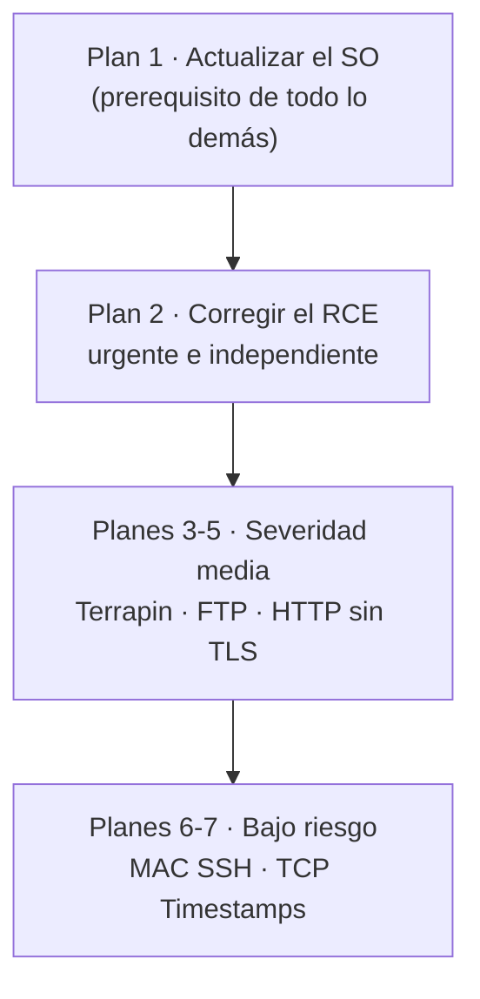

# 🛠️ Planes de mitigación de vulnerabilidades

> Cierre del ciclo del auditor técnico: a partir de las vulnerabilidades detectadas con **Nessus** y **OpenVAS** ([Desafío 2](https://github.com/Cataliniwis/escaneo-vulnerabilidades-nessus-vs-openvas)) y explotadas manualmente ([Desafío 1](https://github.com/Cataliniwis/pentest-web-rce-escalada-suid)), elaboré **7 planes de mitigación** priorizados por severidad, cada uno con contexto, pasos técnicos, validación, recursos, marco normativo y riesgo residual.

> 🔒 Laboratorio aislado en modo NAT. Direcciones IP genéricas.

---

## 📋 Tabla de contenidos

- [Vulnerabilidades tratadas](#-vulnerabilidades-tratadas)
- [Estructura de cada plan](#-estructura-de-cada-plan)
- [Priorización](#-priorización)
- [Mapeo normativo](#-mapeo-normativo)
- [Planes de mitigación](#-planes-de-mitigación)
- [Autora](#-autora)

---

## 🚨 Vulnerabilidades tratadas

| # | Vulnerabilidad | Severidad | CVSS | Tratamiento | Fuente |
|---|---|---|---|---|---|
| 1 | Ubuntu 16.04 — Fin de vida (SEoL) | 🔴 Crítica | 10.0 | Remediación | Nessus |
| 2 | RCE en `/ping/` — OS Command Injection | 🟠 Alta | 7.5 | Remediación | OpenVAS |
| 3 | Terrapin en SSH (CVE-2023-48795) | 🟡 Media | 5.9 | Mitigación | Nessus |
| 4 | FTP anónimo habilitado | 🟡 Media | 6.4 | Mitigación | OpenVAS |
| 5 | HTTP en texto claro (login sin TLS) | 🟡 Media | 4.8 | Remediación | OpenVAS |
| 6 | Algoritmos MAC débiles en SSH | 🟢 Baja | 2.6 | Mitigación | OpenVAS |
| 7 | TCP Timestamps habilitados | 🟢 Baja | 2.6 | Mitigación | OpenVAS |

> **Remediación** = solución definitiva (parche o reemplazo). **Mitigación** = medida paliativa que reduce el riesgo sin eliminar la causa raíz.

---

## 📐 Estructura de cada plan

Cada uno de los 7 planes sigue el mismo formato profesional:

- **Nombre y CVE/identificador** · Severidad y CVSS · Host/puerto · CWE base
- **Marco normativo** (ISO/IEC 27002:2022, CIS Controls v8.1, NIST CSF 2.0, OWASP Top 10)
- **Contexto** — por qué importa
- **Tipo de solución** — remediación o mitigación
- **Pasos técnicos** — comandos concretos
- **Validación** — cómo comprobar que la medida funcionó (repetir el escaneo)
- **Recursos requeridos** — tiempo, personal, herramientas
- **Riesgo residual**

---

## 🎯 Priorización

1. **Ubuntu 16.04 sin soporte** es el prerequisito: sin un SO con parches, cualquier otra mitigación queda sobre una base insegura.
2. El **RCE en `/ping/`** es urgente e independiente de la actualización del SO.
3. Las de **severidad media** (acceso no autorizado o *man-in-the-middle*) se resuelven en el corto plazo.
4. Las **configuraciones de bajo riesgo** pueden ir al mediano plazo sin impacto operacional.

---

## 📚 Mapeo normativo

Cada plan se vincula a marcos reconocidos, por ejemplo:

| Vulnerabilidad | ISO/IEC 27002:2022 | CIS v8.1 | NIST CSF 2.0 | Otros |
|---|---|---|---|---|
| SO fuera de soporte | 8.8 Gestión de vulnerabilidades | Control 2 | ID.AM-2 / PR.IP-12 | CWE-1104 |
| RCE `/ping/` | 8.28 Codificación segura | Control 16 | PR.IP-2 / DE.CM-8 | OWASP A03:2021 · CWE-78 |
| Terrapin SSH | 8.20 / 8.24 | Control 12 | PR.DS-2 | CVE-2023-48795 · CWE-354 |
| FTP anónimo | 8.3 / 5.17 | Control 6 | PR.AC-1 | CWE-306 |
| HTTP sin TLS | 8.24 / 5.14 | Control 3.10 | PR.DS-2 | OWASP A02:2021 · CWE-319 |

---

## 📄 Planes de mitigación

El documento completo con los 7 planes, con todos sus campos, está en:

📁 [`planes/`](./planes) — un archivo Markdown por plan.

**Ejemplos de pasos técnicos:**

- **Plan 1 (SO):** snapshot → evaluar `do-release-upgrade` → migrar a Ubuntu 22.04/24.04 LTS → `unattended-upgrades`.
- **Plan 2 (RCE):** eliminar `/ping/` o reescribirlo con `filter_var($ip, FILTER_VALIDATE_IP)` y `escapeshellarg()`; `disable_functions` en `php.ini`; ModSecurity.
- **Plan 5 (HTTP sin TLS):** `a2enmod ssl`, certificado, redirección 301 a HTTPS y cabecera HSTS.

---

## 👩‍💻 Autora

**Catalina Rebolledo Rojas** · [@Cataliniwis](https://github.com/Cataliniwis)

*Diplomado en Red Team — Auditoría a la Ciberseguridad, Desafío 3* · 2026

**Trabajos relacionados:** [Desafío 1 — Pentest web](https://github.com/Cataliniwis/pentest-web-rce-escalada-suid) · [Desafío 2 — Nessus vs. OpenVAS](https://github.com/Cataliniwis/escaneo-vulnerabilidades-nessus-vs-openvas)

---

## 📄 Licencia

Este proyecto se distribuye bajo la licencia MIT. Ver [LICENSE](./LICENSE).

---

> ⚠️ **Disclaimer:** trabajo académico en un laboratorio aislado y controlado, conforme al marco ético del diplomado y a la Ley 21.459 de 2022 sobre delitos informáticos (Chile). Las direcciones IP y cualquier dato sensible fueron reemplazados.
